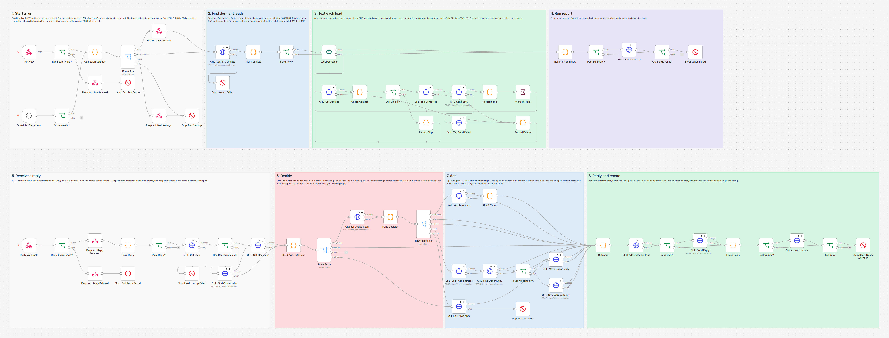
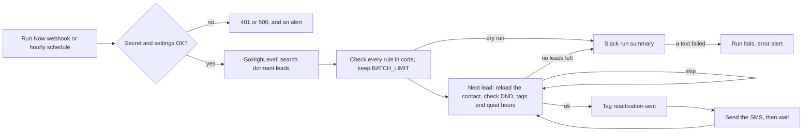
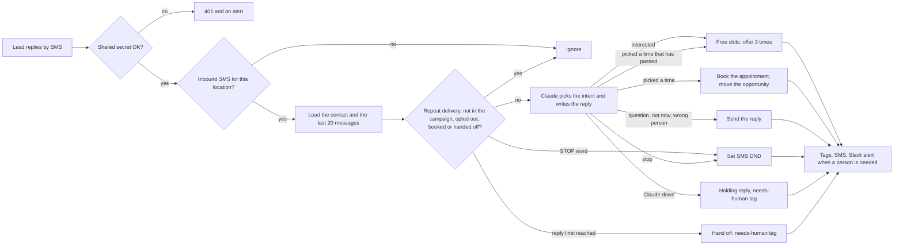

# GoHighLevel AI Lead Reactivation Agent: Claude + n8n

Texts old GoHighLevel leads a short personal SMS, lets Claude handle their replies, offers real open times from your calendar and books the ones who say yes. Built with n8n and Claude.



## The problem

Every GoHighLevel account has a long list of people who asked for a quote or booked once and then went quiet. They already know the business, so they are the cheapest customers to win back. But nobody has time to text them one by one, answer every reply and go back and forth about times. Bulk SMS blasts everyone at once, ignores time zones and opt outs, and leaves the replies sitting in the inbox until they go cold again.

## What this does

1. **Finds dormant leads in GoHighLevel**: contacts with your reactivation tag, or with no activity for 90 days. Anyone with DND on, an opt out, an excluded tag (current customers, for example) or an earlier campaign text is skipped.
2. **Texts them one at a time**, with a short personal SMS from your GoHighLevel number. There is a pause between texts, a cap per run, and texts only go out between 9 AM and 7 PM in the lead's own time zone.
3. **Never texts anyone twice.** Each lead is tagged before the text goes out, so a re-run, a crash or a later run on the same day skips them.
4. **Honors STOP right away.** STOP, UNSUBSCRIBE and the other opt out words set DND for SMS in code, before any AI is involved. The lead gets no further messages.
5. **Lets Claude handle the replies.** Claude reads the conversation and picks one of six intents: interested, picked a time, question, not now, wrong person or stop. It answers questions only from the facts you give it, and never makes up prices or dates.
6. **Books interested leads.** It offers 3 real open times from your GoHighLevel calendar, books the one they pick and moves their opportunity to your "booked" stage. The numbers stay the ones the lead saw, so "2" is always the second time in their text, even after the first one has passed. An open or lost opportunity is reused; a won one is a past sale and is never reopened.
7. **Knows when to hand off.** Questions it cannot answer, upset leads, long chats and Claude outages go to a person: the lead gets a reply (a holding reply if Claude is down, unless their message may be an opt out), the contact gets a `needs-human` tag and your team gets a Slack alert.
8. **Fails loudly.** Any GoHighLevel or Claude failure ends the run as failed, and the error workflow posts the reason and a link to the run in Slack. That includes a reply answered without the conversation history because it could not be loaded. (Slack itself is the exception: if a Slack post fails, the run carries on.)

## How it works

The workflow has two parts. The campaign part finds and texts leads:



The reply part answers the leads who text back. A GoHighLevel workflow (trigger: Customer Replied) forwards each SMS reply to the second webhook:



Both webhooks answer right away (202 for Run Now, 200 for replies) and do the work afterwards, so neither the caller nor GoHighLevel waits.

**Why nobody gets two texts.** The `reactivation-sent` tag on the contact is the record of the send. The search leaves tagged contacts out, and each lead is reloaded just before sending, because GoHighLevel's search index can lag a few seconds behind tag and DND changes. The tag is added before the SMS, so if anything breaks in between, the lead is skipped rather than texted twice.

**Why nobody gets two replies.** Every reply's message id is remembered for 7 days, and a repeat delivery is skipped. This holds even when the run that handled the first copy failed. When the payload has no message id (the GoHighLevel workflow setup in the guide sends none), the id of the matching message in the conversation is used, and only a message from the last 24 hours counts as a match, so a lead who writes "yes" again days later still gets an answer.

## Workflow at a glance

| Step | Nodes | What it does |
|---|---|---|
| 1 | Run Now, Run Secret Valid?, Respond: Run Refused, Stop: Bad Run Secret | POST webhook that starts a campaign run. A wrong or missing `X-Run-Secret` header gets a 401 and an alert |
| 2 | Schedule: Every Hour, Schedule On? | Optional hourly run at five past the hour, only when `SCHEDULE_ENABLED` is true |
| 3 | Campaign Settings, Route Run, Respond: Run Started, Respond: Bad Settings, Stop: Bad Settings | Reads and checks the settings and builds the contact search. Run Now gets a 202 right away, or a 500 that lists every missing or invalid setting |
| 4 | GHL: Search Contacts, Stop: Search Failed | `POST /contacts/search`, page by page: reactivation tag or no activity for `DORMANT_DAYS`, has a phone, no DND, not texted, not excluded |
| 5 | Pick Contacts, Send Now? | Checks every rule again in code (including SMS DND and quiet hours in the lead's time zone) and keeps the first `BATCH_LIMIT`. A dry run stops here |
| 6 | Loop: Contacts, GHL: Get Contact, Check Contact, Still Eligible? | One lead per pass: reloads the contact, checks again and fills in the message |
| 7 | GHL: Tag Contacted, GHL: Send SMS, Record Send, Wait: Throttle | Tags the lead, sends the SMS (`POST /conversations/messages`, type SMS), then waits `SEND_DELAY_SECONDS` |
| 8 | Record Skip, GHL: Tag Send Failed, Record Failure | Skipped and failed leads, with the reason. A rejected SMS adds the `reactivation-send-failed` tag |
| 9 | Build Run Summary, Post Summary?, Slack: Run Summary, Any Sends Failed?, Stop: Sends Failed | Slack summary of who was texted and why others were skipped. Failed texts end the run as failed |
| 10 | Reply Webhook, Reply Secret Valid?, Respond: Reply Received, Respond: Reply Refused, Stop: Bad Reply Secret | Receives replies. Checks the `X-Reactivation-Secret` header, or `customData.secret` from the standard Webhook action |
| 11 | Read Reply, Valid Reply? | Reads both payload shapes and ignores anything that is not an inbound SMS for your location |
| 12 | GHL: Get Lead, Stop: Lead Lookup Failed, Has Conversation Id?, GHL: Find Conversation, GHL: Get Messages | Loads the contact and the last 20 messages of the conversation |
| 13 | Build Agent Context, Route Reply | Skips repeats and leads outside the campaign, handles STOP words, stops after `MAX_AI_REPLIES` replies, and builds the Claude request |
| 14 | Claude: Decide Reply, Read Decision, Route Decision | One Claude call with a forced tool call, so the intent and the reply always come back as clean JSON. A failed call takes the fallback route |
| 15 | GHL: Get Free Slots, Pick 3 Times | Free slots for the next `SLOT_SEARCH_DAYS` days in the lead's time zone. Picks 3, one per day where possible, and skips times they already saw |
| 16 | GHL: Book Appointment, GHL: Find Opportunity, Reuse Opportunity?, GHL: Move Opportunity, GHL: Create Opportunity | Books the picked time, then moves the lead's open (or else lost) opportunity in `GHL_PIPELINE_ID` to `GHL_BOOKED_STAGE_ID`, or creates one. A won opportunity is never touched |
| 17 | GHL: Set SMS DND, Stop: Opt Out Failed | Turns on SMS DND and keeps the contact's other DND channels as they were |
| 18 | Outcome, GHL: Add Outcome Tags, Send SMS?, GHL: Send Reply, Finish Reply | One place decides the SMS, the tags and the alert, then sends them |
| 19 | Post Update?, Slack: Lead Update, Fail Run?, Stop: Reply Needs Attention | Slack for bookings and hand offs. Anything that went wrong ends the run as failed |

## Tags it adds

With the default `TAG_PREFIX=reactivation`:

| Tag | Meaning |
|---|---|
| `reactivation-sent` | Got the campaign text. The campaign never texts them again |
| `reactivation-send-failed` | The text was rejected (for example a landline). Fix the number, then remove both tags to retry |
| `reactivation-replied` | Replied at least once |
| `reactivation-interested` | Asked for times |
| `reactivation-booked` | Booked. The assistant stops replying and your team takes over |
| `reactivation-not-now` | Not interested right now |
| `reactivation-wrong-number` | Wrong person. The assistant stops replying |
| `reactivation-opted-out` | Replied STOP or asked to stop. SMS DND is on |
| `reactivation-needs-human` | Needs a person. The assistant stops replying. Remove the tag to hand the lead back |

## What the leads and the team see

A conversation from the test run (all data made up). The campaign text, the list of times and the confirmation are written by the workflow; the first line of the second text comes from Claude (scripted in the test):

```
Bright Smile Dental: Hi Jamie, this is Bright Smile Dental. It has been a while! Would you like to book
                     your next cleaning? Reply YES and I will send you a few open times. Reply STOP to opt out.
Jamie:               Yes please, I've been meaning to book
Bright Smile Dental: Great to hear from you, Jamie! Here are a few open times:
                     1) Wed, Oct 21, 10:00 AM
                     2) Thu, Oct 22, 10:00 AM
                     3) Fri, Oct 23, 10:00 AM
                     Reply 1, 2 or 3 to book.
Jamie:               2 works for me
Bright Smile Dental: You are booked for Thu, Oct 22, 10:00 AM. See you then! If anything changes, just reply here.
```

In GoHighLevel, the appointment is on the calendar (10:00 to 10:30, confirmed), the opportunity sits in the booked stage, and the contact has the tags `reactivation-sent`, `reactivation-replied`, `reactivation-interested` and `reactivation-booked`.

In Slack, from the same run (the time zone is a test zone; real contacts show theirs, for example `America/Denver`):

```
*Reactivation run* (run now)
Texted: 3 (Jamie Rivera, Ivan Diaz, Jo Banks)
Skipped: 7 (4 over the batch limit, 1 SMS DND, 1 quiet hours, 1 already texted)
Scanned 10 contacts from the search, batch limit 4.
```

```
*Booked from reactivation*: Jamie Rivera (+15550100008)
Thu, Oct 22, 10:00 AM (Etc/GMT+8)
https://app.gohighlevel.com/v2/location/.../contacts/detail/...
```

```
*Reactivation lead needs a person*: Ivan Diaz (+15550100009)
They said: "Do you take PPO insurance?"
Assistant replied: "Good question! I will check with the team about PPO plans and text you back."
Asked about PPO insurance
https://app.gohighlevel.com/v2/location/.../contacts/detail/...
```

## Setup

**You need:** self-hosted n8n reachable over HTTPS, a GoHighLevel sub-account with an SMS number, a calendar and a pipeline, an Anthropic API key and, optionally, a Slack incoming webhook.

1. Import `workflow/error-alert-slack.json` and **activate it**. n8n 2.x only runs an error workflow that is active.
2. Import `workflow/ghl-lead-reactivation-agent.json`. In its settings, choose the error alert workflow as its **Error Workflow**.
3. Add the variables below to your n8n environment and restart n8n. The nodes read them with `$env`, so self-hosted n8n needs `N8N_BLOCK_ENV_ACCESS_IN_NODE=false`. (n8n Cloud does not allow `$env`. There, replace `$env.` with `$vars.` and create the same names under Variables.)
4. Activate the workflow. It listens on `/webhook/ghl-reactivation-run` (campaign runs) and `/webhook/ghl-reactivation-reply` (replies).
5. In GoHighLevel, create a workflow with the **Customer Replied** trigger (channel SMS) that calls the reply URL with your shared secret.
6. Start with a dry run, then a run with `BATCH_LIMIT=1` on your own contact.

Step by step, with the token scopes, the GoHighLevel workflow, the first run and troubleshooting: [docs/setup.md](docs/setup.md).

| Variable | Required | Where to find it |
|---|---|---|
| `GHL_API_KEY` | yes | GoHighLevel → Settings → Private Integrations. Token starts with `pit-`. The 9 scopes it needs are listed in [docs/setup.md](docs/setup.md) |
| `GHL_LOCATION_ID` | yes | GoHighLevel → Settings → Business Profile |
| `GHL_CALENDAR_ID` | yes | The calendar's settings page; the ID is in the URL |
| `GHL_PIPELINE_ID` | yes | `GET /opportunities/pipelines` (one curl call, shown in the setup guide) |
| `GHL_BOOKED_STAGE_ID` | yes | Same call: the stage a booked lead should land in |
| `ANTHROPIC_API_KEY` | yes | console.anthropic.com → API keys |
| `RUN_NOW_SECRET` | yes | Any long random string. Send it in the `X-Run-Secret` header to start a run |
| `REPLY_WEBHOOK_SECRET` | yes | Any long random string. The GoHighLevel workflow sends it as a header or as `customData.secret` |
| `BUSINESS_NAME` | recommended | The name the texts and the assistant use, for example "Bright Smile Dental" (default "our team") |
| `REACTIVATION_OFFER` | no | What you invite them back for (default "your next visit") |
| `BUSINESS_ABOUT` | no | One line about the business, for Claude |
| `BUSINESS_FAQ` | no | The only facts Claude may use to answer questions: hours, parking, what a visit takes. Anything else goes to a person |
| `REACTIVATION_MESSAGE` | no | Your own first text. Placeholders `{first_name}`, `{business_name}`, `{offer}`. A STOP line is added if it has none |
| `REACTIVATION_TAG` | no | Tag that marks leads to wake up (default `reactivate`) |
| `DORMANT_DAYS` | no | Also include leads with no activity for this many days (default 90, 0 means tag only) |
| `EXCLUDE_TAGS` | no | Comma separated tags that are never texted, for example `customer-active` |
| `TAG_PREFIX` | no | Prefix for the tags the workflow adds (default `reactivation`) |
| `BATCH_LIMIT` | no | Most texts per run (default 20, at most 100) |
| `SEND_DELAY_SECONDS` | no | Pause between texts (default 20) |
| `SEARCH_PAGE_SIZE`, `MAX_SEARCH_PAGES` | no | How many contacts one run looks at (default 100 per page, 5 pages) |
| `SEND_HOUR_START`, `SEND_HOUR_END` | no | Texting window in the lead's local time (default 9 to 19) |
| `BUSINESS_TZ` | no | Time zone for leads without one (default `America/New_York`) |
| `SCHEDULE_ENABLED` | no | `true` turns on the hourly run (default off; Run Now always works) |
| `APPOINTMENT_MINUTES` | no | Length of a booked appointment (default 30) |
| `SLOT_SEARCH_DAYS` | no | How far ahead to look for open times (default 7, at most 30) |
| `MAX_AI_REPLIES` | no | Assistant replies per lead before a person takes over (default 6) |
| `DND_ALL_CHANNELS` | no | `true` sets DND on every channel after an opt out, not only SMS |
| `ANTHROPIC_MODEL` | no | Default `claude-sonnet-5`. `claude-haiku-4-5` is cheaper, `claude-opus-5` also works. The Claude Fable and Mythos models and `claude-opus-5-5` do not: they refuse a forced tool call or thinking turned off, so a campaign run refuses to start with them |
| `GHL_FROM_NUMBER` | no | Number the texts go out from (default: the location's default number) |
| `GHL_APP_URL` | no | Your white label app domain, for contact links in Slack (default `https://app.gohighlevel.com`) |
| `SLACK_WEBHOOK_URL` | no | Slack incoming webhook for summaries, bookings, hand offs and error alerts. Leave it empty to skip Slack |

Only text people who agreed to hear from you. In the US, sending SMS through a GoHighLevel number also needs A2P 10DLC registration.

## Testing

The workflow was tested end to end on n8n 2.19.5 against **mock GoHighLevel, Claude and Slack APIs**, so no real account was touched and no real text was sent. The mock GoHighLevel keeps real state (contacts, tags, DND, conversations, a calendar with open times, opportunities) and rejects requests the real v2 API would reject: a wrong token, the wrong `Version` header for the endpoint, unknown body properties, unknown search fields or operators, slots that are not free, a second opportunity in the same pipeline, texts to contacts with DND, and so on. The mock Claude returns scripted answers but rejects malformed Messages API requests. The real Claude request was also checked against Anthropic's free token counting endpoint, which validates the request shape and the forced tool call without generating anything (it does not check the `thinking` setting; that rule comes from Anthropic's model docs).

The test also imports and activates the error alert workflow and checks that every failed run raised exactly one alert, linked to that run.

All 73 checks across 50 scenarios pass:

| Scenario | Result |
|---|---|
| Run Now with a wrong or missing secret | 401, nothing searched or sent, alert |
| Run Now with broken settings (including a Claude model that refuses the request) | 500 listing every problem, no API call, alert with the same list |
| Dry run | 202 at once, search only, Slack lists who would be texted and why others were skipped |
| Campaign run | 3 eligible leads texted, each tagged before the text, at least `SEND_DELAY_SECONDS` apart. DND, SMS DND, no phone, excluded tag, quiet hours (3 AM there) and recently active leads skipped |
| Lead with no or an invalid time zone | Uses `BUSINESS_TZ`: texted when it is daytime there, skipped for quiet hours when `BUSINESS_TZ` is at 3 AM |
| Search index behind the contact | A lead the search still shows as untexted is caught by the fresh contact check |
| GoHighLevel rate limit (429) on a text | Retried, the lead gets exactly one text |
| Tag call fails / SMS rejected | Lead not texted / tagged `send-failed`; the other leads still go out; run flagged with both names |
| Re-runs | Only leads never texted before; a fourth run texts nobody. Every eligible lead got exactly one text across all runs |
| GoHighLevel search down | Retried 3 times, nobody texted, alert |
| Reply webhook with a wrong or missing secret | 401, nothing loaded or sent |
| Lead is interested | Claude gets the history and the facts; 3 real open times offered, one per day, in the lead's time zone |
| Lead picks a time | Appointment booked for that exact slot (+30 minutes, same offset), opportunity created in the booked stage, confirmation SMS, Slack alert |
| The first offered time has passed, lead texts "2" | Claude sees the times with the numbers the lead saw (the first marked as passed), and the second time from the lead's text is booked, not the third |
| Lead picks the time that has passed | Nothing booked; the lead is told and gets 3 new times they have not seen |
| Lead has an old lost opportunity | It is reopened and moved to the booked stage, no duplicate |
| Lead's only opportunity is won | Left untouched. A new one is tried, GoHighLevel refuses the duplicate, the lead is still confirmed and the run is flagged |
| Picked time was taken in the meantime | GoHighLevel refuses the booking; honest SMS, needs-human tag, alert |
| Question Claude cannot answer | Reply sent, needs-human tag, Slack alert |
| Not now / wrong person | Friendly reply and tag; the assistant then stays quiet for a wrong number |
| STOP / "please don't text me anymore" | SMS DND set (other DND channels kept), opted-out tag, no reply, nothing ever sent again |
| Same reply delivered twice (with or without a message id, also after a failed run) | Second copy ignored |
| Same words as an older reply, two days later, without a message id | Answered as a new message |
| Booked, opted out or wrong number lead writes again | No Claude call, no SMS, no tags |
| Booked lead texts CANCEL | Honored as an opt out (SMS DND, no reply), and Slack tells the team the appointment is still on the calendar |
| Contact outside the campaign, an email reply, another location | Ignored |
| Reply limit reached | Handed to a person, no more AI replies |
| A lead texts `<!here>` | Escaped in the Slack alert, so it cannot ping the channel |
| Claude down (529) or no tool call | Holding reply, needs-human tag, alert with the lead's words |
| Claude down and the message contains an opt out word ("Please stop sending these") | No holding reply, needs-human tag, alert, so a person decides |
| Contact cannot be loaded | Retried 3 times, nothing sent, run flagged with the contact id and their message |
| Conversation history cannot be loaded | Retried 3 times, the lead still gets an answer, the run is flagged |
| Calendar down / no open times | Honest holding SMS and a hand off; only the outage is flagged as failed |
| Opportunity update fails after booking | The lead still gets the confirmation; run flagged |
| DND update fails after STOP | Nothing texted, URGENT alert to set DND by hand |
| Reply SMS rejected | Run flagged with the text to send by hand |
| Hourly schedule off / on | Off: does nothing. On: texts a newly tagged lead by itself |

Full results, the requests the workflow sent and the API checks: [docs/test-report.md](docs/test-report.md). Run the same tests yourself with [tests/e2e_mock_test.py](tests/e2e_mock_test.py). What testing and review found and fixed is in [CHANGELOG.md](CHANGELOG.md).

## What it handles when things go wrong

| Situation | What happens |
|---|---|
| A forged call to either webhook | 401, nothing loaded or sent, and an alert. An empty secret setting refuses everything |
| A setting is missing or wrong | Run Now answers 500 with the list. The schedule fails the run with the same list. Nobody is texted while replies could not be handled |
| GoHighLevel rate limit or a short outage | API calls are retried 3 times, 2 seconds apart. The two creates that must never run twice (the appointment and a new opportunity) are not retried; if they fail, a person takes over |
| A text is rejected | The lead is tagged `send-failed`, the run continues with the next lead and ends as failed with each name and reason |
| The run crashes halfway | Leads already tagged are skipped next time; nobody gets a second text |
| GoHighLevel delivers a reply twice | The message id is remembered for 7 days and the repeat is skipped |
| Claude is down or answers without the tool call | The lead gets a holding reply, the contact gets the needs-human tag, and the run is flagged with the lead's words. If the message contains an opt out word (stop, unsubscribe, cancel and so on), no holding reply is sent, because it may be an opt out; a person decides |
| A setting would break the reply side (an empty calendar or pipeline ID, a Claude model that refuses the request) | A campaign run refuses to start, so nobody is texted who could not get an answer |
| Lead texts STOP | DND for SMS is set before any AI call. If GoHighLevel refuses the update, an URGENT alert says to set it by hand |
| A booked lead texts CANCEL (or another opt out word) | It is honored as an opt out, as carriers require. The workflow never cancels an appointment by itself, so Slack tells the team the booking is still on the calendar |
| The lead answers after one of the offered times has passed | The other times keep their numbers. If they pick the one that passed, they are told and get new times |
| The picked time is gone | GoHighLevel refuses the booking, the lead is told a person will confirm a time, and the team is alerted |
| The conversation history cannot be loaded | The lead is still answered (Claude sees only the newest message), and the run is flagged, because it usually means a missing `conversations` scope |
| The calendar is down or full | The lead is told a person will send times, the team is alerted |
| The booking works but the opportunity update fails | The lead is still confirmed; the alert says which step to finish by hand |
| The lead's only opportunity in the pipeline is won | It is left as it is, so your sales history stays right. A new opportunity is created; if the sub-account does not allow multiple opportunities per contact, GoHighLevel refuses it and the alert says to add it by hand |
| The reply SMS is rejected | The alert includes the exact text to send by hand |
| A lead's name or text contains Slack markup such as `<!channel>` | Lead names, lead messages and Claude's replies have `&`, `<` and `>` escaped before they reach Slack, so the markup shows as text and pings nobody |

## Cost

Campaign texts do not use Claude. Each reply is one Claude call of about 1,400 to 1,700 input tokens (measured with Anthropic's token counter on the test chat) and usually under 150 output tokens. On `claude-sonnet-5` ($2 per million input tokens, $10 per million output tokens) that is about half a cent per reply; `claude-haiku-4-5` is cheaper still. SMS is billed by GoHighLevel at your LC Phone rates.

## Limitations and next steps

- Reply state (offered times, reply counts, message ids already handled) lives in n8n's workflow static data. n8n saves it as one block per workflow, so two replies processed at the same moment can overwrite each other's changes. At worst a lead is offered times again or a repeat delivery is not caught. Campaign runs never write to it, so they cannot overwrite reply state. At higher volume, move it to Redis, Postgres or an n8n data table.
- GoHighLevel has no idempotency key for sending messages. If a send times out after GoHighLevel already accepted it, the retry can send the same text twice. Rate limit errors are safe to retry because nothing was sent.
- Request shapes follow GoHighLevel's published OpenAPI files and API docs, and were tested against mocks only. One known doc quirk: the current `POST /conversations/messages` schema marks `subType` and `status` as required, which only fits custom providers; the workflow sends the documented SMS fields (`type`, `contactId`, `message`). Run the dry run and a one lead test on a real sub-account before a full campaign.
- Run one campaign at a time. Two runs that overlap (for example a Run Now call while the hourly run is still sending) work through the same list, and in a rare race both can reload a lead in the same split second, before either has tagged it, and text it twice. The workflow has no lock that stops a second run from starting, so keep the schedule off while you start campaigns by hand.
- One run looks at up to `SEARCH_PAGE_SIZE` x `MAX_SEARCH_PAGES` contacts (500 by default). Texted leads drop out of the search, so large lists are worked through over several runs. Leads the code skips every time (SMS DND on that channel only, or an invalid number) stay in the search, though. If hundreds of them fill the first pages, the summary shows them as skipped and nobody new is texted: remove the reactivation tag from them or raise `MAX_SEARCH_PAGES`.
- The dry run lists who the search found and who passes the rules on that data. A real run reloads each lead first, so it can text fewer people than the dry run listed (the test shows one such lead).
- Replies are answered at any hour, because the lead just wrote. Only campaign texts follow the quiet hours.
- Once a lead is booked, handed to a person or marked as a wrong number, the assistant ignores their messages. STOP and the other opt out words still set DND (for a booked lead, Slack is told the appointment is still on the calendar), but an opt out in plain words ("please stop texting me") is left to the person who took over.
- Booking only creates the appointment. Rescheduling and cancelling are left to your team, and GoHighLevel's own calendar notifications still go out (`toNotify` is on), so turn off the calendar's SMS confirmation if leads should only get the assistant's.
- Every refused webhook call raises a Slack alert. That is useful as a warning, but a flood of forged calls would also flood Slack; put n8n behind a proxy with rate limits for public use.
- API keys are read from environment variables. For production, move them into n8n credentials so they never appear in the workflow.
- The prompts and the time labels are written in English (en-US).

## About

Built by **Romiel Inolino**, AI and CRM Automation Specialist working with GoHighLevel, Monday.com, ClickUp, n8n, Make and Zapier.
Portfolio and case studies: [romielwillautomate.dev](https://romielwillautomate.dev)

This repository is a portfolio implementation. Credentials, API keys and customer data are not included, and all test data is made up.
